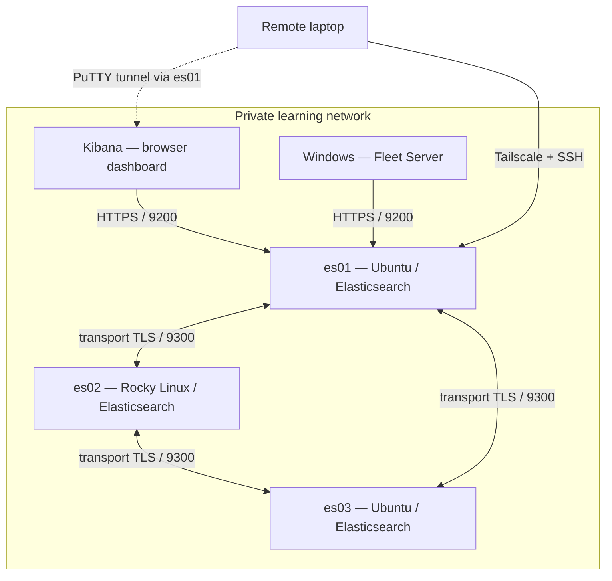

# Elasticsearch Learning Lab 

**A beginner-friendly, practical homelab journey:** Linux → a 3-node Elasticsearch cluster → Kibana → Fleet Server → secure remote access.

> **First time learning servers? Start here.** You don't need to understand every term before beginning. Each guide explains **what**, **why**, **how**, and **how to check it worked**. Take one step at a time.

## What will you build?

**Important:** The arrows show the *learning architecture*, not a complete multi-host production configuration. Three Elasticsearch nodes form one cluster; Fleet Server in this example was initially configured to reach **one** Elasticsearch HTTP endpoint. In production, plan redundancy and consistent TLS trust. The laptop-to-Kibana arrow represents tunneling through es01, **not direct public access**.

## What are these tools? (plain English)

| Term | What it means | Simple analogy |
| --- | --- | --- |
| **Linux** | Operating system running the servers | The foundation of a house |
| **Elasticsearch** | Stores, searches and analyzes indexed data | A searchable library |
| **Node** | One computer running Elasticsearch | One library branch |
| **Cluster** | Multiple Elasticsearch nodes working together | A group of branches |
| **Kibana** | Web application for exploring and managing Elastic | The library dashboard |
| **TLS / CA** | Encryption and certificate-based trust | Sealed envelope + trusted ID |
| **Fleet Server** | Coordinates enrolled Elastic Agents | An agent management desk |
| **Elastic Agent** | Collects and sends host/application data | A data collector |
| **SSH** | Secure command-line connection to another computer | A protected remote terminal |
| **Tailscale** | Private network between approved devices | A secure path between locations |
| **PuTTY `.ppk`** | A PuTTY SSH private key | A personal login key |
| **SSH tunnel** | Forwards a port through an SSH connection | A private passage to a website |

## Start here — learning path

| Order | Guide | You will learn |
| --- | --- | --- |
| 0 | [Before you start](guides/00-before-you-start.md) | Hardware, OS, IPs, safety and prerequisites |
| 1 | [Install and join Elasticsearch](guides/01-elasticsearch-cluster.md) | Nodes, repositories, discovery, TLS and cluster health |
| 2 | [Kibana dashboard](guides/02-kibana.md) | How Kibana connects securely to Elasticsearch |
| 3 | [Fleet Server on Windows](guides/03-fleet-server-windows.md) | Certificates, Fleet policy, install and health verification |
| 4 | [Remote access with Tailscale + PuTTY](guides/04-remote-access.md) | VPN, jump host, `.ppk`, SSH tunneling to Kibana |
| 5 | [Troubleshooting examples](guides/05-troubleshooting.md) | Errors encountered during the real learning lab |
| 6 | [Next learning exercise: Linux Agents](guides/06-next-steps-linux-agents.md) | An **uncompleted exercise** to enroll more agents |

Prefer Word? See [optional Word guides](word-guides/). **GitHub Markdown is the primary, easier-to-follow version.**

## Learning status

| Component | Result in the documented hands-on lab |
| --- | --- |
| 3-node Elasticsearch cluster | **Completed and verified GREEN** |
| Kibana | **Completed and accessible** |
| Windows Fleet Server with HTTPS | **Completed and verified HEALTHY** |
| Windows Elastic Agent (Fleet Server host) | **Completed and HEALTHY** |
| Tailscale jump host + PuTTY | **Completed and tested** |
| PuTTY SSH key login | **Completed and tested** |
| Kibana SSH tunnel | **Documented configuration**; users should test in their environment |
| Separate Linux Elastic Agents on all 3 ES nodes | **Not yet completed**; tutorial is a suggested next step |

##  Before copying commands

- **Example network values are fictional** (`192.168.50.0/24`). Replace them with IPs actually assigned in your own lab. Never assign an example IP blindly.
- `YOUR_...` and `<...>` mean **you must replace the placeholder**. Never type placeholder brackets literally unless a guide says so.
- Commands differ between **Ubuntu (`apt`)**, **Rocky (`dnf`)** and **Windows (`CMD`)**. Look at the heading before executing.
- The lab examples are based on the **Elastic 9.x family**. Pin matching supported versions and read the current official docs before installing. Software options can change.
- **Do not run destructive cleanups** on an existing cluster. Don't delete `/var/lib/elasticsearch` to fix an unexplained error.
- This is a **learning guide**, not a hardened production deployment. Never publish a reachable Elasticsearch, Kibana, Fleet Server or SSH port directly to the internet as part of this exercise.

## Privacy and security

No actual home IPs, tailnet addresses, emails, usernames, tokens, private keys, certificate bundles or unredacted screenshots are included. The [`.gitignore`](.gitignore) blocks common secret formats — **still check every file before committing**.

For terms, credits, and official documentation, see [References](REFERENCES.md). Contributions that improve the explanations are welcome.
